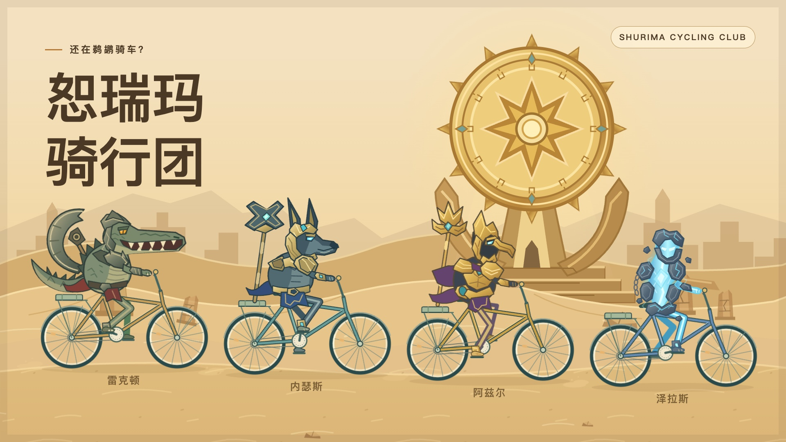

# 恕瑞玛骑行团

从一只鹈鹕骑自行车开始，最后让雷克顿、内瑟斯、阿兹尔和泽拉斯在太阳圆盘下组队骑行。

纯 HTML / SVG / JavaScript 实现的 2D 动画，无需安装依赖，下载后直接用浏览器打开 `index.html` 即可播放。

## 逐步开发历史

七次需求变更分别对应七个提交。每一步的 `index.html` 都是当时保存的完整版本；最新目录 `stages/` 也汇总了所有阶段，方便直接下载与对照。

| 阶段 | 内容 | 完整代码 | Git 历史 |
| --- | --- | --- | --- |
| 01 | 鹈鹕单人骑行 | [HTML](stages/01-pelican.html) | [提交](https://github.com/Jiang-liran/shurima-cycling/commit/32808af29345e5584cabfeba8edb2d0d1418ba4d) · [标签](https://github.com/Jiang-liran/shurima-cycling/tree/stage-01-pelican) |
| 02 | 鳄鱼单人骑行 | [HTML](stages/02-crocodile.html) | [提交](https://github.com/Jiang-liran/shurima-cycling/commit/483cc69df575236fd270e9188c776f1e7e060f11) · [标签](https://github.com/Jiang-liran/shurima-cycling/tree/stage-02-crocodile) |
| 03 | 鹈鹕与鳄鱼一起骑行 | [HTML](stages/03-two-friends.html) | [提交](https://github.com/Jiang-liran/shurima-cycling/commit/9a86b06b2de09a74f087c6c62e1eb4dccf16bb18) · [标签](https://github.com/Jiang-liran/shurima-cycling/tree/stage-03-two-friends) |
| 04 | 加入小狗，三人骑行 | [HTML](stages/04-three-friends.html) | [提交](https://github.com/Jiang-liran/shurima-cycling/commit/498e1cd3c1180b2771227e67a40a14afd957d2b7) · [标签](https://github.com/Jiang-liran/shurima-cycling/tree/stage-04-three-friends) |
| 05 | 鳄鱼和小狗变为雷克顿与内瑟斯 | [HTML](stages/05-renekton-nasus.html) | [提交](https://github.com/Jiang-liran/shurima-cycling/commit/aee287009074ce87e8af3979d473b73957eee167) · [标签](https://github.com/Jiang-liran/shurima-cycling/tree/stage-05-renekton-nasus) |
| 06 | 阿兹尔与泽拉斯加入四人组 | [HTML](stages/06-four-champions.html) | [提交](https://github.com/Jiang-liran/shurima-cycling/commit/b64e0784c012a7bd47a2a618f5d025532de0c29d) · [标签](https://github.com/Jiang-liran/shurima-cycling/tree/stage-06-four-champions) |
| 07 | 恕瑞玛沙漠与太阳圆盘 | [HTML](stages/07-shurima-desert.html) | [提交](https://github.com/Jiang-liran/shurima-cycling/commit/a38baba47b89ebc29cbc50b04ec17d005add1cf6) · [标签](https://github.com/Jiang-liran/shurima-cycling/tree/stage-07-shurima-desert) |

[查看全部提交](https://github.com/Jiang-liran/shurima-cycling/commits/main/) · [下载当前完整源码](https://github.com/Jiang-liran/shurima-cycling/archive/refs/heads/main.zip) · [阶段说明](HISTORY.md)

历史根据保留的阶段快照于 2026-10-22 补建，提交时间为补建时间。最初的一次性上传保留在 `archive/initial-upload` 分支；`v1.0.0` 的成片和封面下载链接继续有效。

## 动画

- 四位英雄独立踩踏，车轮、披风、尾巴、石甲和能量光效持续运动。
- 恕瑞玛沙漠、太阳圆盘、层叠沙丘和扬尘形成场景。
- 支持暂停、0.5×–2× 调速、移动端布局和减少动态效果偏好。

## 视频

**还在鹈鹕骑车？来试试我们的恕瑞玛骑行团**

[在 B 站观看](https://www.bilibili.com/video/BV16Fn26HE8c/)

36 秒，1920×1080，30 fps，H.264 / AAC。包含鹈鹕开场、四位英雄特写、中文字幕、原创合成配乐及音效。

[下载 MP4 成片](https://github.com/Jiang-liran/shurima-cycling/releases/download/v1.0.0/shurima-cycling-bilibili.mp4) · [查看完整发布包](https://github.com/Jiang-liran/shurima-cycling/releases/tag/v1.0.0)

## 文件

| 文件 | 内容 |
| --- | --- |
| `index.html` | 完整的恕瑞玛四人骑行动画 |
| `examples/pelican.html` | 最初的鹈鹕骑行动画，也是视频开场素材 |
| `examples/crocodile.html` | 鳄鱼骑行动画 |
| `assets/cover.jpg` | 16:9 视频封面 |
| `assets/cover-4x3.jpg` | 4:3 推荐封面 |

## 创作说明

动画、剪辑和合成配乐由 AI 辅助创作。角色来自《英雄联盟》，本项目为趣味同人创作；相关角色与世界观权利归原权利人所有。
